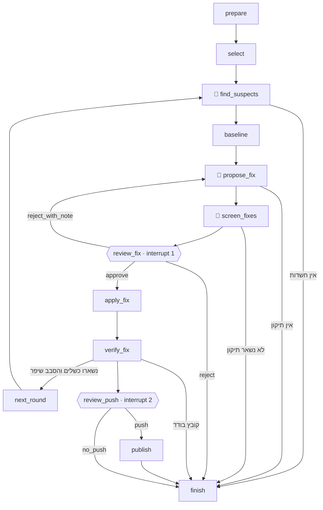
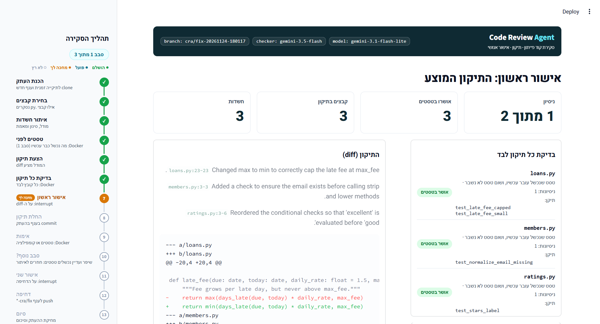
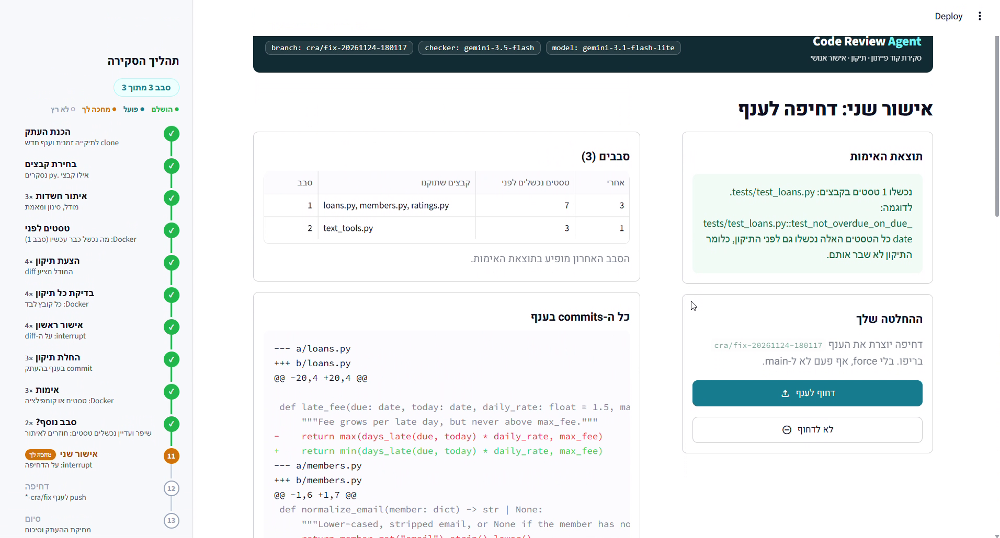

# Code Review Agent

**סוכן סקירת קוד שלא מבקש ממך לסמוך עליו. הוא מוכיח.**

כלי סקירה מבוססי AI מציפים הערות "אולי זה None", ומציעים תיקונים שנראים נכונים ושוברים משהו אחר. Code Review Agent הופך את הסדר: המודל רק מעלה השערות, והקוד מנסה להפריך אותן. כל תיקון רץ מול הטסטים של הריפו בקונטיינר מבודד לפני שמישהו רואה אותו. מה שמגיע אלייך הוא תיקון עם ראיה, ולא עוד דעה.

נותנים לו קישור לגיט, תיקייה או קובץ פייתון. הוא מאתר באגי off-by-one, טיפול חסר ב-None ושגיאות לוגיקה, מתקן, בודק, ודוחף לענף חדש רק באישורך.

| | |
|---|---|
| **ראיה לכל תיקון** | כל תיקון נבדק לבד מול הטסטים של הריפו ומסומן "אושר בטסטים" או "לא הוכח". תיקון ששבר טסט לא מגיע למפתחת. |
| **המאמת מדרג, הטסטים מכריעים** | המאמת חייב להציג קלט שמפיל את הקוד. חשד שהוא זרק נשאר אם הטסטים מאשרים אותו. |
| **בטוח לקוד אמיתי** | עבודה על העתק בלבד, וקוד רץ רק בקונטיינר בלי רשת. הדחיפה רק לענף `cra/fix-*`, בלי force. |
| **סבבים** | אחרי תיקון מאושר הסוכן פותח סבב נוסף על הקוד המתוקן. יש עד 3 סבבים ו-5 תנאי עצירה. |
| **נמדד** | 9 באגים אמיתיים מ-BugsInPy, עם שופט אובייקטיבי, ניסויי before/after ב-LangSmith ומשפך שמראה איפה כל באג אבד. |

---

## הגרף

13 צמתים ו-2 interrupts. יש 3 לולאות: דחייה עם הערה, ניסיון שני ב-`screen_fixes`, וסבב נוסף. 🔷 = קריאה למודל.



| שלב | צמתים | מה קורה |
|---|---|---|
| הכנה | `prepare`, `select` | הסוכן יוצר העתק (clone בלי hooks ובלי submodules) וענף. קבצי טסט, וקבצים קצרים או ארוכים מדי, מדולגים. |
| איתור | `find_suspects`, `baseline` | איתור חשדות, סינון ומאמת. אחר כך הטסטים רצים לפני התיקון, כדי לא להאשים אותו בכשל קיים. |
| תיקון | `propose_fix`, `screen_fixes` | המודל מקבל רק את הפונקציה. כל תיקון נכתב לבד ונבדק בטסטים, והקובץ מוחזר ב-`finally`. |
| אישור 1 | `review_fix` | `interrupt()` עם ה-diff, הקלט המפיל ותוצאת הבדיקה. אפשר approve, ‏reject, או reject עם הערה. |
| החלה | `apply_fix`, `verify_fix`, `next_round` | commit בהעתק, ואחריו כל הטסטים שוב. הכשלים שנשארו הם ה-baseline של הסבב הבא. |
| אישור 2 | `review_push`, `publish`, `finish` | אישור אחד בסוף, על ה-diff המצטבר. בלי הרשאת push נשמר `cra_fix.patch`. ‏`finish` תמיד מוחק את ההעתק. |

## הקריאות למודל

כל הקריאות עוברות דרך `Reviewer._invoke` ב-`core/llm.py`. הוא מנסה שוב בשגיאות זמניות (503, ‏429, ‏timeout וניתוק). הפלט מובנה (`with_structured_output` + pydantic), ופלט שלא מתאים לסכמה נזרק.

| צומת | קריאה | קלט | פלט |
|---|---|---|---|
| `find_suspects` | `find_suspects`, אחת לכל קובץ, במקביל | הקובץ עם שורות ממוספרות, וחתימות של מה שהוא מייבא מהריפו | `reason`, `bug_type`, `line`, `confidence` (1-5) |
| `find_suspects` | `check_suspect` (המאמת), אחת לכל חשד, במקביל, על מודל נפרד | הפונקציה בלבד, והטענה | `failing_input`, `expected`, `actual`, `is_bug` |
| `propose_fix` | `propose_fixes` | הפונקציה, החשדות, והערת הדחייה אם הייתה | `start_line`, `end_line`, `new_code`, `explanation` |
| `screen_fixes` | `propose_fixes`, ניסיון שני | גם פלט הטסט והתיקון הקודם (המודל לא זוכר אותם) | אותו מבנה |

בשאר 10 הצמתים אין קריאה למודל. הם קוד רגיל, Docker או החלטה אנושית.

## משפך החשדות

```
מודל: חיפוש ──► קוד: איחוד ±3 שורות, סף ביטחון 3 ──► מודל אחר: מאמת (קלט מפיל) ──► קוד: תקרה 3 ──► Docker: הטסטים מכריעים
```

ב-before הסוכן תיקן כל חשד: 35 חשדות, מהם 5 אמיתיים. תיקון "הגנתי" בקובץ נקי שבר טסט והפיל גם תיקון נכון. כל שלב במשפך הוא מנגנון בקוד, לא ניסוח בפרומפט. הערכים נמצאים ב-`core/config.py`.

## החלטות מרכזיות

| החלטה | למה | נדחה |
|---|---|---|
| "תיקן" = הטסט שנכשל עובר, שום טסט לא נשבר, וקבצי טסט לא שונו | מדידה לפי הרצה | שופט LLM כמדד ראשי |
| שני אישורים אנושיים | רואים את תוצאות הטסטים לפני שמשהו יוצא | אישור אחד |
| כל הרצת קוד ב-Docker: בלי רשת, עם מגבלות משאבים ו-image לכל ריפו | ההעתק מגן על הקבצים, ו-Docker מגן על המחשב | הרצה על המחשב |
| כל תיקון נבדק לבד (`screen_fixes`) | ביחד לא יודעים מי שבר ומי תיקן | בדיקה אחת לכולם |
| המאמת לא שער | הוא זרק באגים אמיתיים (thefuck_25, ‏27) | מאמת בינארי |
| האיתור לא רואה את הטסטים שנכשלים | ב-BugsInPy הטסט מצביע על הבאג, וזו הייתה דליפה | fault localization מהטסטים |
| המודל מקבל רק את הפונקציה (`ast`) וחתימות של מה שמיובא | למודל אין זיכרון בין קריאות | קבצים שלמים, prompt caching |
| רמת החשיבה באיתור = ברירת המחדל של המודל | נמדד: low ו-medium פספסו, ו-high עלה פי 38 טוקנים | low לחיסכון בזמן |
| בהערכה `--rounds 1` | בכל פריט יש באג אחד, וכך ההשוואה הוגנת | סבבים בהערכה |
| `core` בלי ממשק | אותו גרף מה-CLI, מההערכה ומ-Streamlit | לוגיקה ב-`streamlit_app.py` |

יומן מלא: [DECISIONS.md](DECISIONS.md).

## הערכה

**test:** 9 באגים אמיתיים מ-BugsInPy (7 מ-thefuck, ‏httpie_3 ו-pysnooper_3). כל באג אומת: הטסט נכשל בקוד הבאגי ועובר אחרי התיקון המקורי. **dev:** שני ריפוזיטוריז שכתבתי (`library_tracker` עם טסטים, ו-`order_reports` בלי).
**מדדים:** recall ו-precision (חשד באותו קובץ, ±3 שורות), ‏fix rate, טוקנים וזמן.
מודלים: `gemini-3.1-flash-lite` לאיתור ולתיקון, ו-`gemini-3.5-flash` כמאמת.

| ניסוי | פריטים | recall | precision | fix rate | טוקנים | זמן לפריט |
|---|---|---|---|---|---|---|
| before | 7 | 0.57 | 0.14 | 0.00 | 38,887 | ~70s |
| after v10 | 7 | 0.57 | 0.58 | 0.43 | 83,226 | ~200s |
| after v10 | 8 | 0.62 | 0.64 | 0.50 | 106K | ~184s |
| **after-v13**, 2 הרצות | 8 | **0.50–0.62** | **0.57–0.62** | **0.50** | 119K–123K | ~168–179s |

- **התיקון יציב:** בשתי ההרצות תוקנו אותם 4 באגים (thefuck_1, ‏27, ‏32 ו-pysnooper_3), ואף תיקון לא שבר טסט אחר.
- **הטווח ב-recall** נובע מ-thefuck_18. הטסטים שלו לא אמינים, ולכן המאמת קובע לבד.
- **המחיר:** פי 2-3 טוקנים וזמן מול before, בעיקר בגלל הרצות Docker. מעט תיקונים מוכחים עדיפים על הרבה תיקונים מסוכנים.

הניסויים ב-LangSmith (דאטהסט `cra-test`):


## תוצאה סופית על סט שלא כויל

ה-test שימש לפיתוח ולהשוואת before/after. ה-dev נשמר בצד עד הסוף: 10 באגים בשני ריפוזיטוריז, שאף מנגנון של שלב 6 לא כויל עליהם. זו התוצאה הסופית של המוצר כפי שהוא מוגש (v13, ‏`--rounds 3`, כמו בשימוש אמיתי).

| ריפו | באגים | recall | precision | fix rate | איפה הבאגים נעצרו |
|---|---|---|---|---|---|
| `library_tracker` (עם טסטים) | 6 | 0.83 | 1.00 | **0.83** | 5 תוקנו, 1 לא נחשד |
| `order_reports` (בלי טסטים) | 4 | 0.75 | 1.00 | (אין טסטים) | 3 נמצאו ונבדקו בקומפילציה, 1 נחתך בתקרה |
| **ממוצע** | 10 | **0.79** | **1.00** | **0.83** | 0 חשדות שגויים |

עלות: 38 קריאות למודל ו-22 אלף טוקנים לשני הריפוזיטוריז יחד. ב-`order_reports` אין טסטים, ולכן יש סבב אחד, ואחד הבאגים נחתך בתקרה של 3 תיקונים לסבב.
הסתייגות: את ריפוזיטוריז ה-dev כתבנו לפרויקט, והם פשוטים יותר מ-BugsInPy. זה התחום שהמוצר מכוון אליו: קוד פייתון ברמת מורכבות פשוטה עד בינונית.

## Traces ותובנות

הריצה על `library_tracker` ב-LangSmith. אחרי `verify_fix` בא `next_round`, ואחריו `find_suspects` שוב: זה הסבב השני. בקלט של `find_suspects` רואים שהשדות של הסבב הקודם (`decision`, `diff`) התאפסו, ו-`applied_diff` ו-`commit_sha` נשמרו:

| | |
|---|---|
|  |  |

1. **מאמת LLM מעדיף את הרעש.** קל להראות קלט שמפיל "חוסר בדיקת None", וקשה להראות קלט שמפיל regex שגוי. ב-thefuck_27 המאמת זרק את הבאג האמיתי (ביטחון 5) והשאיר חשד הגנתי. לכן המאמת רק מדרג, והטסטים מכריעים.
2. **הקשר הוא לא שיפור חינמי.** `repo_context` העביר את thefuck_32 ל-fixed. באותו זמן thefuck_25, שנמצא בכל 6 ההרצות הקודמות, כבר לא נחשד. התוצאה נטו: אפס. בלי שתי הרצות לא הייתי רואה את זה.
3. **הפרומפט חוזר בכל קריאה** כי למודל אין זיכרון. לכן מצמצמים את מה שנשלח, ולא מנסים "לזכור".

## מגבלות

- הדאטהסט קטן (9 באגים, 7 מהם מ-thefuck). כל פריט נסקר על 4 קבצים ולא על ריפו שלם.
- התוצאות לא דטרמיניסטיות גם ב-temperature 0.
- באגי כוונה (thefuck_2, ‏12) לא נמצאו: הקוד נראה תקין בלי מפרט.
- בלי טסטים התיקון נבדק רק בקומפילציה, והממשק מציג "לא נבדק בטסטים".
- httpie_3 לא נבנה מאחורי proxy מסנן. בממשק, רענון של הדף מאבד את הריצה (`MemorySaver`).

**צעד הבא:** self-consistency באיתור, כלומר שני מעברים ואיחוד החשדות.

---

## עמידה בדרישות התרגיל

| דרישה | איפה |
|---|---|
| LangGraph | `core/graph.py`, `core/nodes.py` |
| לולאה / ענף מותנה | לולאת סבבים, ‏`reject_with_note`, ניסיון שני, 6 ענפים מותנים |
| interrupt + human-in-the-loop | `review_fix`, `review_push` |
| דאטהסט והערכה ב-LangSmith | `eval/datasets/`, `eval/metrics.py`, `eval/run_eval.py` |
| ניסוי לפני ואחרי | `before`, `after-v13` על `cra-test` |
| README עם trace ותובנה | [Traces ותובנות](#traces-ותובנות) |
| Streamlit מעל core | `streamlit_app.py`, `ui/` |

## ממשק Streamlit

ריצה אמיתית על `library_tracker`: שלושה סבבים, 5 תיקונים שאושרו בטסטים, ודחיפה לענף.

| | |
|---|---|
|  |  |
| **הפתיחה:** מפת הגרף בצד | **אישור 1, סבב 1:** ה-diff ובדיקת כל תיקון לבד |
|  |  |
| **סבב 2:** הסוכן חוזר לאיתור על הקוד המתוקן | **אישור 2:** טבלת הסבבים (7 → 3 → 1 טסטים נכשלים) |
|  |  |
| **תוצאה:** החשדות וההוכחה של כל אחד | **GitHub:** הענף החדש, 3 commits לפני main |

## התקנה והרצה

דרישות: Python 3.11+, ‏Git ו-Docker Desktop. הוראות ל-Windows ול-proxy: [SETUP_WINDOWS.md](SETUP_WINDOWS.md).

```powershell
python -m venv .venv; .\.venv\Scripts\Activate.ps1
pip install -r requirements.txt
copy .env.example .env               # GOOGLE_API_KEY, LANGSMITH_API_KEY
python -m scripts.docker_check

streamlit run streamlit_app.py       # ממשק
python -m scripts.run_cli <url | תיקייה | קובץ.py>

python -m eval.run_eval --dataset test --name after-v13                    # הרצה מקומית, נשמרת אחרי כל פריט
python -m eval.run_eval --dataset test --langsmith --name after-v13 `
       --from-results eval/results/after-v13_test_gemini-3.1-flash-lite.json  # העלאה ל-LangSmith בלי קריאות למודל

python -m pytest tests -q --ignore=tests/test_docker_real.py              # 152 בדיקות, בלי רשת
```

| משתנה | תפקיד |
|---|---|
| `MODEL_NAME` / `CHECK_MODEL_NAME` | מודל האיתור והתיקון / מודל המאמת |
| `MAX_ROUNDS` | סבבים בריצה (ברירת מחדל 3) |
| `FIND_THINKING_LEVEL` | ריק = ברירת המחדל של המודל (מומלץ) |
| `MAX_PARALLEL_CALLS` | קריאות במקביל באיתור ובמאמת (4) |
| `WORKSPACE_DIR`, `DOCKER_PIP_EXTRA_ARGS` | מיקום ההעתקים, ו-pip מאחורי proxy |

## מבנה

```
core/      graph · nodes · llm · filtering · code_context · repo_context
           sandbox · git_ops · publish · docker_runner · verify · state · config
eval/      datasets · metrics · run_eval · snapshot
ui/        session (AgentSession) · flow (מפת הגרף)
scripts/   run_cli · docker_check
tests/     152 בדיקות עם מודל ו-Docker מדומים
```
