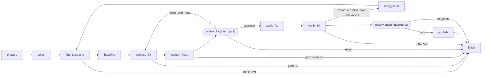

# Code Review Agent

**סוכן לסקירת קוד שלא מסתפק בדעה של מודל שפה: כל תיקון שהוא מציע מוכח בהרצה, לפני שאדם רואה אותו.**

כלי סקירה מבוססי LLM נוטים להציף הערות "אולי זה None" ולהציע תיקונים שנראים סבירים ושוברים קוד אחר. Code Review Agent בנוי הפוך: המודל מעלה השערות, והקוד מנסה להפריך אותן. כל חשד עובר סינון ומאמת שחייב להציג קלט שמפיל את הקוד. כל תיקון מוחל לבד בהעתק מבודד ב-Docker ונבדק מול הטסטים של הריפו. תיקון ששובר משהו מקבל ניסיון שני עם פלט הכשל, ואם הוא שובר שוב, הוא לא מגיע אל המפתחת. מה שנשאר מגיע עם ראיה: "אושר בטסטים" או "לא הוכח".

- **ראיות, לא ניחושים:** ההכרעה הסופית היא תוצאת הרצה, לא ציון של מודל. המאמת משמש לדירוג, והטסטים מכריעים.
- **בטוח לשימוש על קוד אמיתי:** עובד על העתק בלבד, מריץ קוד רק בקונטיינר בלי רשת, ודוחף רק לענף חדש אחרי שני אישורים אנושיים.
- **מכל מקור:** קישור לגיט, תיקייה מקומית או קובץ בודד. עם טסטים או בלי, ובלי טסטים הוא אומר במפורש שהתיקון לא הוכח.
- **נמדד, לא מובטח:** הערכה אוטומטית על באגים אמיתיים מ-BugsInPy ב-LangSmith, עם שופט אובייקטיבי (הטסט שנכשל עובר, ושום דבר לא נשבר) וניסויי before/after.

תחום: באגי off-by-one, טיפול חסר ב-None ושגיאות לוגיקה ב-Python.

> **למרצה:** מיפוי דרישות התרגיל לקוד נמצא ב[טבלת הדרישות](#עמידה-בדרישות-התרגיל), ותוצאות הניסוי ב[הערכה](#הערכה-before--after).
> **למפתחים:** [התקנה](#התקנה), [שימוש](#שימוש) ו[מבנה הקוד](#מבנה-הקוד).

---

## מה הסוכן עושה

1. מקבל קישור לגיט, תיקייה מקומית או קובץ `.py` בודד, ויוצר ממנו **העתק** זמני (sandbox).
2. בוחר קבצים לסקירה. קבצי טסט, קבצים קצרים מדי וקבצים ארוכים מדי מדולגים.
3. **מאתר חשדות:** המודל סוקר כל קובץ ומחזיר שורות חשודות עם ציון ביטחון. אחר כך הן עוברות סינון: איחוד כפילויות, סף ביטחון, ומאמת שחייב להציג קלט שמפיל את הקוד.
4. **מציע תיקון:** המודל מקבל רק את הפונקציה הרלוונטית, ומחזיר החלפה של טווח שורות.
5. **בודק כל תיקון לבד** (`screen_fixes`) מול הטסטים ב-Docker. תיקון ששובר טסט, או שלא תיקן טסט שנכשל, מקבל ניסיון שני עם פלט הטסט. נשארים רק תיקונים שלא שברו כלום.
6. **אישור אנושי 1:** חשדות, diff ותוצאת הבדיקה של כל תיקון. אפשר לאשר, לדחות, או לדחות עם הערה, והדחייה עם הערה חוזרת למודל (לולאה).
7. מחיל את התיקון בהעתק, עושה commit בענף `cra/fix-*`, ומריץ את כל הטסטים שוב.
8. **אישור אנושי 2:** לדחוף או לא. רק אישור מפעיל `push`. בלי הרשאת push נשמר `cra_fix.patch`.
9. מוחק את ההעתק בכל מסלול.



## עמידה בדרישות התרגיל

| דרישה | איפה |
|---|---|
| LangGraph | `core/graph.py` (13 צמתים), `core/nodes.py` |
| לולאה או ענף מותנה | לולאת סבבים (`verify_fix` → `next_round` → `find_suspects`, עם 5 תנאי עצירה), לולאת `reject_with_note` (`review_fix` → `propose_fix`, עד 2 ניסיונות), ניסיון שני ב-`screen_fixes`, 6 ענפים מותנים |
| interrupt + human-in-the-loop | `review_fix` (approve / reject / reject עם הערה) ו-`review_push` (push / no_push). ההחלטה קובעת אם קובץ נכתב ואם ענף נדחף |
| דאטהסט והערכה אוטומטית ב-LangSmith | `eval/datasets/` (dev + test), `eval/metrics.py`, `eval/run_eval.py --langsmith` |
| ניסוי לפני ואחרי | ניסויי `before` ו-`after` על הדאטהסט `cra-test` ([תוצאות](#הערכה-before--after)) |
| README עם trace ותובנה | [Traces ותובנה](#traces-ותובנה) |
| Streamlit מעל core | `streamlit_app.py` ו-`ui/` ([ממשק Streamlit](#ממשק-streamlit)). ב-`core` אין `print`, `input` או `streamlit` |

## בטיחות

- **העתק בלבד:** כל העבודה בתיקייה זמנית ייחודית (`cra_sandbox_*`), והיא היחידה שנמחקת. יש רשת ביטחון שמסרבת למחוק תיקייה בלי הקידומת.
- **Docker לכל הרצת קוד:** קונטיינר חד-פעמי, בלי רשת, עם מגבלות זיכרון, CPU ותהליכים, משתמש רגיל, ומערכת קבצים לקריאה בלבד. רק ההעתק נטען לקונטיינר.
- **git:** `clone` בלי submodules ובלי hooks. הדחיפה רק לענף עם הקידומת `cra/fix-`, בלי force, ורק אחרי `review_push`.
- **מפתחות:** רק ב-`.env`, ואף פעם לא בקוד.

## התקנה

דרישות: Python 3.11+, Git ו-Docker Desktop פעיל.

```powershell
python -m venv .venv
.\.venv\Scripts\Activate.ps1          # Linux/macOS: source .venv/bin/activate
pip install -r requirements.txt
copy .env.example .env                # ולמלא את המפתחות
python -m scripts.docker_check        # בונה את image הבסיס ובודק את Docker
```

| משתנה ב-`.env` | חובה | תפקיד |
|---|---|---|
| `GOOGLE_API_KEY` | כן | מפתח Gemini |
| `MODEL_NAME` | לא | מודל האיתור והתיקון (ברירת מחדל `gemini-3.1-flash-lite`) |
| `CHECK_MODEL_NAME` | לא | מודל המאמת. מומלץ מודל אחר מ-`MODEL_NAME`, למשל `gemini-3.5-flash` |
| `LANGSMITH_API_KEY`, `LANGSMITH_TRACING`, `LANGSMITH_PROJECT` | להערכה ול-traces | LangSmith |
| `WORKSPACE_DIR` | לא | תיקיית אב להעתקים (ברירת מחדל: התיקייה הזמנית של מערכת ההפעלה) |
| `DOCKER_PIP_EXTRA_ARGS` | לא | ארגומנטים ל-pip בבניית images, למשל מאחורי proxy מסנן |
| `FIND_THINKING_LEVEL` | לא | רמת החשיבה של שלב האיתור (`low`/`medium`/`high`). ריק = ברירת המחדל של המודל (מומלץ, ראו "רמת חשיבה") |
| `MAX_ROUNDS` | לא | מספר סבבים מקסימלי בריצה (ברירת מחדל 3; 1 = סבב אחד) |
| `MAX_PARALLEL_CALLS` | לא | כמה קריאות למודל במקביל באיתור ובמאמת (ברירת מחדל 4; 1 = בזו אחר זו) |

הוראות מפורטות ל-Windows, כולל SSL מאחורי proxy: [SETUP_WINDOWS.md](SETUP_WINDOWS.md).

> **מאחורי proxy מסנן עם `truststore`:** אם ב-`.venv` מותקן `truststore_auto.pth` (חיבור אישורי Windows ל-SSL), pip עלול להיכשל ב-`RecursionError`, כי גם הוא מחבר את truststore בפעם השנייה. הפתרון: `python -m pip install --use-deprecated=legacy-certs -r requirements.txt`. אין למחוק את הקובץ, כי הקריאות לרשת תלויות בו.

## שימוש

```powershell
python -m scripts.run_cli https://github.com/user/repo
python -m scripts.run_cli C:\repos\my-repo --include app/utils.py
python -m scripts.run_cli C:\code\script.py
```

הסוכן עוצר פעמיים לאישור בטרמינל. בסוף נכתב `cra_report.md`: הקבצים שנסקרו, החשדות שעברו ושנזרקו (עם הסיבה), תוצאת הבדיקה של כל תיקון, ה-diff, ההחלטות והעלות בטוקנים.

### ממשק Streamlit

```powershell
streamlit run streamlit_app.py        # נפתח בדפדפן: http://localhost:8501
```

Docker Desktop צריך להיות פעיל, וחלון הטרמינל נשאר פתוח כל זמן העבודה (Ctrl+C עוצר). בשדה "מקור" כותבים כתובת GitHub, נתיב לתיקייה או נתיב לקובץ, ולוחצים "הרץ סקירה". בצד המסך מוצגת מפת הגרף, עם הצומת שבו הסוכן נמצא כרגע. הסוכן עוצר בשני מסכי אישור:

1. **אישור התיקון (`review_fix`):** ה-diff, החשדות עם הקלט המפיל, ותוצאת הבדיקה של כל קובץ מול הטסטים. אפשר לאשר, לדחות, או לדחות עם הערה שהמודל יקבל בניסיון הבא.
2. **אישור הדחיפה (`review_push`):** "דחוף לענף" יוצר ענף `cra/fix-*` ודוחף אותו. "לא לדחוף" מסיים בלי לגעת בריפו, ומאפשר להוריד את התיקון כ-`cra_fix.patch`.

**סבבים: עד 3 תיקונים בכל סבב, ועד 3 סבבים בכל ריצה.** בכל סבב הסוכן מתקן עד 3 חשדות (`MAX_SUSPECTS`), את אלה עם הביטחון הגבוה ביותר שעברו את המאמת. מעט תיקונים בטוחים עדיפים על הרבה תיקונים מסוכנים. אחרי שהתיקון אושר ונבדק, הסוכן פותח **סבב נוסף על הקוד המתוקן** (`next_round`), ומגיע לבאגים הבאים. הוא עוצר כשאין יותר טסטים שנכשלים, כשסבב לא הוריד את מספרם, כשנשבר טסט, או אחרי `MAX_ROUNDS` סבבים (ב-`.env`, ברירת מחדל 3). כל סבב מאושר בנפרד, וכל התיקונים נכנסים לאותו ענף, עם אישור דחיפה אחד בסוף. בריפו בלי טסטים יש סבב אחד, כי אין דרך לדעת אם סבב שיפר משהו. דוגמה שהובילה לזה: ב-`library_tracker` (6 באגים) סבב אחד העביר 4 טסטים מכישלון להצלחה ולא שבר כלום, ו-3 טסטים נשארו.

בסוף אפשר להוריד את הדוח המלא. כל הלוגיקה נמצאת ב-`core`, והממשק רק מציג אותה ושולח את התשובות לגרף (`ui/session.py`).

## מבנה הקוד

| נתיב | תפקיד |
|---|---|
| `core/graph.py` | בניית הגרף: צמתים, קשתות וניתוב. בלי לוגיקה |
| `core/nodes.py` | הצמתים, כולל `find_suspects` (סינון) ו-`screen_fixes` (בדיקת כל תיקון לבד) |
| `core/llm.py` | שלוש קריאות למודל: `find_suspects`, `check_suspect`, `propose_fixes`. פלט מובנה (pydantic) |
| `core/filtering.py` | סינון חשדות בקוד רגיל: איחוד, דירוג, סף |
| `core/code_context.py` | חיתוך הפונקציה הרלוונטית עם `ast`, כדי שהמודל לא יקבל את כל הקובץ |
| `core/repo_context.py` | חתימות של מה שהקובץ מייבא מהריפו (def/class ושורת docstring), עם `ast` ובלי מודל |
| `core/sandbox.py`, `core/git_ops.py`, `core/publish.py` | העתק, clone, ענף, commit ו-push |
| `core/docker_runner.py`, `core/verify.py` | הרצת טסטים וקומפילציה ב-Docker, ו-image לכל ריפו עם הספריות שלו |
| `core/state.py`, `core/config.py` | מבנה ה-State וכל הערכים הקבועים |
| `eval/` | דאטהסטים, מדדים והרצת ניסויים (מקומית או ב-LangSmith) |
| `scripts/run_cli.py` | ממשק טרמינל |
| `streamlit_app.py`, `ui/session.py`, `ui/flow.py` | ממשק Streamlit: תצוגה בלבד. `AgentSession` שומר את הגרף בין לחיצות, ו-`flow.py` מציג את מפת הגרף |
| `tests/` | בדיקות עם מודל ו-Docker מדומים (בלי רשת ובלי מכסה) |
| `DECISIONS.md` | יומן החלטות: מה הוחלט, למה, ומה נדחה |

## הערכה (before / after)

**דאטהסטים**
- `dev`: שני ריפוזיטוריז שנכתבו לפרויקט. `library_tracker` כולל טסטים ו-6 באגים, ו-`order_reports` בלי טסטים ועם 4 באגים.
- `test`: 9 באגים אמיתיים מ-[BugsInPy](https://github.com/soarsmu/BugsInPy): 7 מ-thefuck, httpie 3 ו-PySnooper 3. כל באג אומת: הטסט נכשל בקוד הבאגי ועובר אחרי התיקון המקורי. פירוט ב-[eval/datasets/TEST_SET.md](eval/datasets/TEST_SET.md).

**מדדים** (`eval/metrics.py`)
- **recall / precision:** חשד "פוגע" אם הוא באותו קובץ ובטווח ±3 שורות מהבאג. נמדד גם בשורה מדויקת.
- **fix rate:** הטסט שנכשל עובר אחרי התיקון, אף טסט אחר לא נשבר, וקבצי טסט לא שונו. זה שופט אובייקטיבי, בלי LLM.
- `raw_precision` / `raw_recall`: אותם מדדים לפני הסינון. כך רואים כמה הסינון זרק, ואם זרק באג אמיתי.
- עלות: קריאות, טוקנים וזמן.

**תוצאות** (`gemini-3.1-flash-lite`, מאמת `gemini-3.5-flash`)

אותם 7 פריטים בשני הניסויים (httpie_3 לא נבנה בסביבה, ו-pysnooper_3 _TODO_):

| ניסוי | recall | precision | fix rate | חשדות לפריט | קריאות למודל | טוקנים | זמן לפריט |
|---|---|---|---|---|---|---|---|
| before | 0.57 | 0.14 | 0.00 | 4.6 | 53 | 38,887 | ~70s |
| after (v10) | 0.57 | 0.58 | 0.43 | 1.0 | 82 | 83,226 | ~200s |

precision עלה פי 4, ושיעור התיקון עלה מ-0 ל-3 מתוך 7. המחיר: פי 2.1 טוקנים ופי 3 זמן, בעיקר בגלל הרצות הטסטים ב-Docker. ה-recall לא השתנה, כי הסינון לא יכול למצוא באג שהמודל לא חשד בו (thefuck_2, 12, 32).

**אחרי v10 (הרצות ממוקדות על thefuck_2, 12, 32):** הקשר מהריפו (v11) העביר את thefuck_32 ל-`fixed`. בהרצה אחרת thefuck_2 תוקן ו-32 לא זוהה. כלומר, המודל מסוגל למצוא את שניהם, אבל כל הרצה בודדת משתנה. thefuck_12 לא זוהה באף הרצה. _TODO: הרצה מלאה על v12.1 ושורה שלישית בטבלה._

_TODO: צילום מסך של השוואת הניסויים ב-LangSmith._

```powershell
python -m eval.run_eval --dataset test --quick --name try1              # 3 פריטים, לפיתוח
python -m eval.run_eval --dataset test --langsmith --name after         # ניסוי מלא (סבב אחד; --rounds לשינוי)
python -m eval.run_eval --dataset test --langsmith --name before --from-results eval/results/before_test_gemini-3.1-flash-lite.json
```

`--from-results` מעלה קובץ תוצאות שמור כניסוי, בלי להריץ את הסוכן שוב.

## מה שופר בשלב 6, ולמה

ב-before הסוכן תיקן כל חשד. 35 חשדות, מהם 5 אמיתיים. תיקון "הגנתי" בקובץ נקי שבר טסט, ובגלל זה גם תיקון נכון נספר כנכשל. השיפורים הם מנגנונים, לא ניסוח פרומפט:

| מנגנון | הבעיה שהוא פותר |
|---|---|
| ציון ביטחון, איחוד כפילויות ±3 שורות, סף ותקרה של 3 | יותר מדי חשדות |
| מאמת: קריאה נפרדת שחייבת להציג קלט מפיל | חשדות "אולי זה None" בלי ראיה |
| `screen_fixes`: כל תיקון נבדק לבד מול הטסטים | תיקון שגוי אחד הסתיר תיקון נכון |
| ניסיון שני עם פלט הטסט והתיקון הקודם | תיקון בכיוון הנכון שלא תיקן (thefuck_1) |
| חשד שהמאמת זרק נבדק בטסטים, ונשאר רק אם תיקן טסט | המאמת זרק באגי לוגיקה אמיתיים (thefuck_25, 27) |
| אימות ותיקון מקבלים רק את הפונקציה (`ast`) | כל קובץ נשלח שוב ושוב בכל קריאה |
| חתימות של מה שהקובץ מייבא מהריפו (`repo_context`) | המודל לא ידע מה מחזירות פונקציות מקבצים אחרים, וניחש "אולי None" (thefuck_32) |
| משפך `lost_at`: לכל באג, באיזה שלב הוא נעצר | מספר כמו recall לא אמר איפה לשפר |
| קריאות במקביל לאיתור ולמאמת | זמן ריצה. `screen_fixes` נשאר בזה אחר זה, כי כל התיקונים נכתבים לאותו העתק |

האיתור עצמו לא רואה טסטים, ומקבל קוד בלבד. הטסטים משמשים רק לאימות. החלטנו כך כי טסט שנכשל מצביע על הבאג, ושימוש בו באיתור היה מודד משימה אחרת.

### רמת חשיבה: מדידה ולא הנחה

ניסינו להוריד את רמת החשיבה של האיתור כדי לקצר זמן. מדידה על thefuck_32, הרצה אחת לכל רמה:

| רמה | תוצאה | זמן | טוקני פלט |
|---|---|---|---|
| ברירת המחדל של המודל | fixed | 97s | 6,865 |
| low | not_suspected | 99s | 9,558 |
| medium | not_suspected | 205s | 72,548 |
| high | fixed | 228s | 264,971 |

חשיבה נמוכה כמעט לא חסכה זמן, כי רוב הזמן הולך על Docker, והיא פגעה באיתור. high מצא את הבאג, אבל בפי 38 טוקנים. לכן נשארה ברירת המחדל, שנמדדה על כל המדגם. ההשוואה מבוססת על פריט אחד בלבד, ולכן היא אינדיקציה ולא הוכחה.

## Traces ותובנה

_TODO: צילום trace של הגרף המלא, וצילום של `screen_fixes` עם ניסיון שני._

**למה הפרומפט חוזר ב-LangSmith:** למודל אין זיכרון בין קריאות. כל קריאה שולחת מחדש את ההוראות, את סכמת ה-JSON ואת הקוד שהיא צריכה. לכן מצמצמים את מה שנשלח (רק הפונקציה, רק חתימות), ולא מנסים "לזכור".

**תובנה:** ה-traces הראו שהמאמת מעדיף בדיוק את הרעש. קל להראות קלט שמפיל "חוסר בדיקת None", וקשה להראות קלט שמפיל regex שגוי בלי להריץ את הקוד. ב-thefuck_27 המודל מצא את הבאג האמיתי בביטחון 5, והמאמת זרק אותו והשאיר חשד הגנתי. המסקנה: מאמת מבוסס LLM טוב לדירוג אבל לא כשער. כשיש טסטים, ההכרעה עוברת אליהם.

## מגבלות

- הדאטהסט קטן (9 באגים ב-test). 8 מהם באגי לוגיקה, ו-7 מ-thefuck. התוצאות מוטות לקבצים קצרים מהסוג הזה.
- בהערכה כל פריט נסקר על 4 קבצים (הבאגי ו-3 נקיים) ולא על ריפו שלם. לכן ה-recall גבוה יותר מאשר בשימוש אמיתי.
- התוצאות לא דטרמיניסטיות גם ב-temperature 0. כדאי להריץ כל ניסוי יותר מפעם אחת.
- עד 3 תיקונים בסבב ועד 3 סבבים. סבבים נוספים רק כשיש טסטים, כי בלעדיהם אין מדד לשיפור (ראו [ממשק Streamlit](#ממשק-streamlit)).
- בריפו בלי טסטים התיקון נבדק רק בקומפילציה, והממשק מציג "לא נבדק בטסטים".
- מחיר: בדיקת כל תיקון לבד מוסיפה הרצות Docker, כ-200 שניות לפריט במקום כ-70.
- httpie_3 לא רץ בסביבה מאחורי proxy מסנן (שגיאת hash בהורדת חבילה).
- ב-thefuck_18 כ-173 טסטים נכשלים כבר לפני הסקירה (בעיית סביבה ב-Docker), והם מסתירים את בדיקת התיקון.
- **באגי כוונה:** ב-thefuck_12 חסר תנאי (`not which(...)`), והקוד נראה תקין לגמרי. רק מי שיודע מה הכלל אמור לעשות יכול לזהות את זה. ב-thefuck_2 הבאג (`':'` במקום `os.pathsep`) מופיע רק ב-Windows. סוקר שקורא קוד בלי מפרט ובלי טסטים יתקשה בבאגים כאלה. לא נתנו לאיתור את הטסטים שנכשלים, כי ב-BugsInPy זה חושף את התשובה.

## בדיקות

```powershell
python -m pytest tests -q --ignore=tests/test_docker_real.py   # 147 בדיקות (כולל הממשק), בלי רשת
python -m pytest tests/test_docker_real.py                    # מול Docker אמיתי
```
