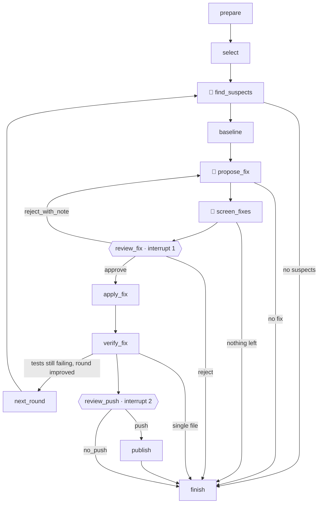
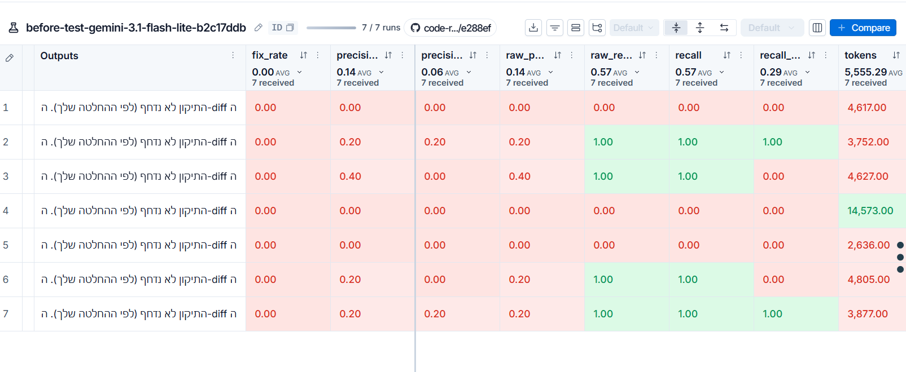
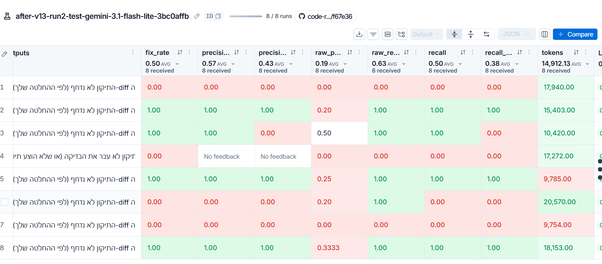
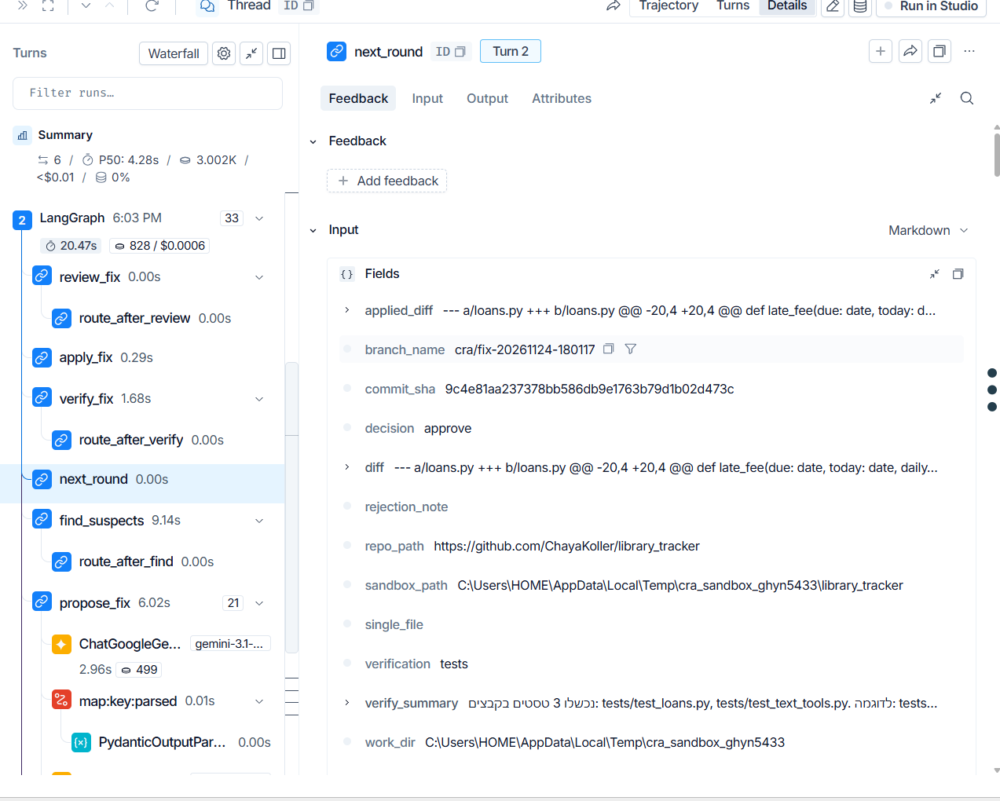
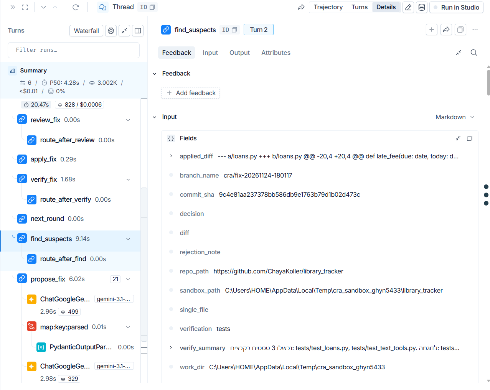
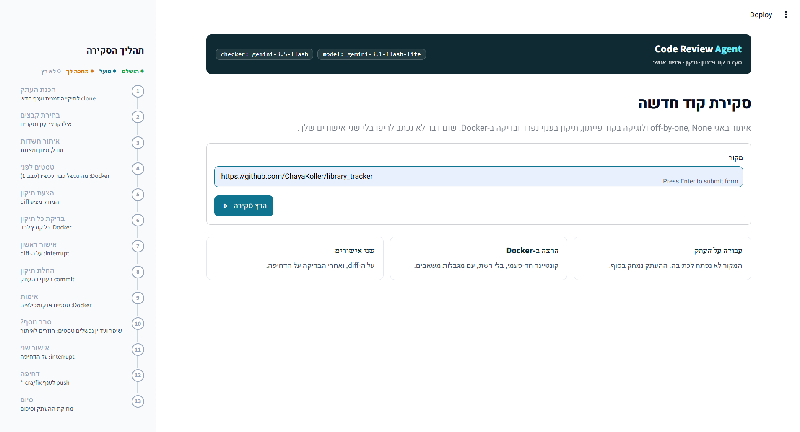
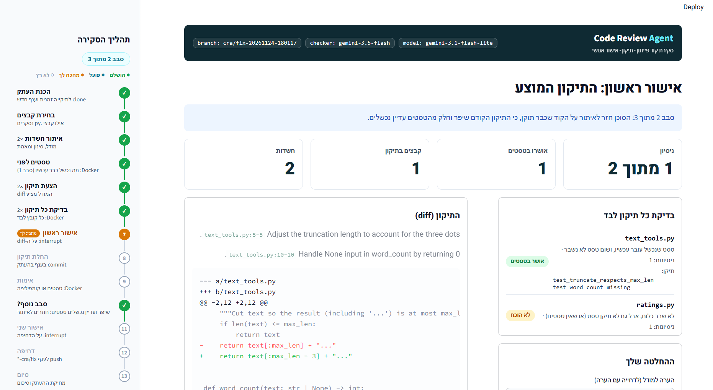
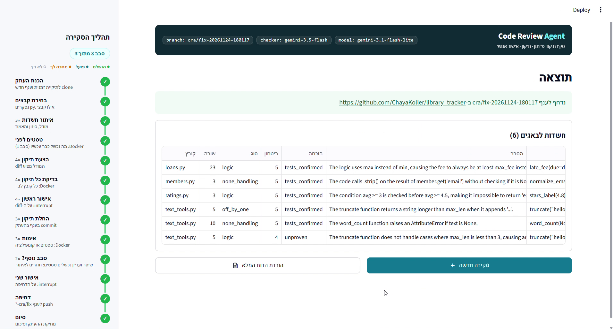
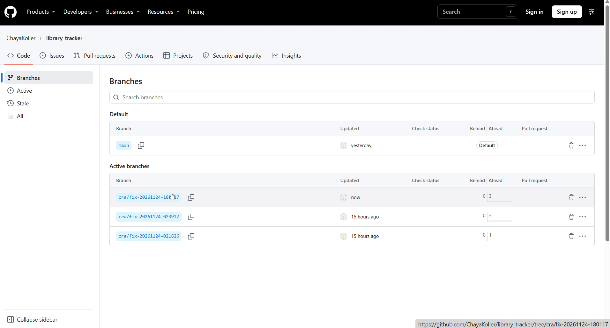

<div dir="rtl">

# Code Review Agent

**סוכן לסקירת קוד שלא מבקש ממך לסמוך עליו. הוא מוכיח.**

כלי סקירה מבוססי AI נוטים להציף הערות כמו "אולי כאן יש None", ולהציע תיקונים שנראים נכונים אבל שוברים משהו אחר.
הסוכן הזה עובד הפוך: המודל רק מעלה השערות, והקוד מנסה להפריך אותן.
כל תיקון רץ מול הטסטים של הפרויקט, בקונטיינר מבודד, לפני שמישהו רואה אותו. מה שמגיע אלייך הוא תיקון עם הוכחה, ולא עוד דעה.

**מה הוא עושה:** מקבל קישור ל-GitHub, תיקייה או קובץ פייתון. מאתר שלושה סוגי באגים: חריגה באחד (off-by-one), טיפול חסר ב-None, ושגיאות לוגיקה. מציע תיקון, בודק אותו, ודוחף לענף חדש רק באישורך.

| | |
|---|---|
| **הוכחה לכל תיקון** | כל תיקון נבדק לבד מול הטסטים, ומסומן "אושר בטסטים" או "לא הוכח". תיקון ששובר טסט לא מגיע אלייך. |
| **הטסטים מכריעים** | מודל נוסף (המאמת) חייב להראות קלט שמפיל את הקוד. גם אם הוא פסל חשד, החשד נשאר אם הטסטים מאשרים אותו. |
| **בטוח לקוד אמיתי** | עובד רק על העתק. קוד רץ רק בקונטיינר בלי רשת. דוחף רק לענף חדש, אף פעם לא ל-main. |
| **סבבים** | אחרי תיקון מאושר, הסוכן פותח סבב נוסף על הקוד המתוקן. עד 3 סבבים, עם 5 תנאי עצירה. |
| **נמדד** | נבדק על באגים אמיתיים, עם שופט אובייקטיבי (הטסטים), וניסויי לפני ואחרי ב-LangSmith. |

---

## הגרף

13 צמתים ושתי עצירות לאישור אנושי (interrupt). שלוש לולאות: דחייה עם הערה, ניסיון תיקון שני, וסבב נוסף. הסימן 🔷 מציין צומת שקורא למודל.

<div dir="ltr">



</div>

| שלב | צמתים | מה קורה |
|---|---|---|
| הכנה | `prepare`, `select` | יוצר העתק של הפרויקט וענף חדש. מדלג על קבצי טסט ועל קבצים קצרים או ארוכים מדי. |
| איתור | `find_suspects`, `baseline` | המודל מעלה חשדות, הקוד מסנן, והמאמת בודק. אחר כך מריצים את הטסטים כדי לדעת מה נכשל עוד לפני התיקון. |
| תיקון | `propose_fix`, `screen_fixes` | המודל מקבל רק את הפונקציה הרלוונטית. כל תיקון נכתב לבד, נבדק בטסטים, והקובץ מוחזר למצבו. |
| אישור ראשון | `review_fix` | עצירה: את רואה את התיקון ואת תוצאות הבדיקה. אפשר לאשר, לדחות, או לדחות עם הערה למודל. |
| החלה ובדיקה | `apply_fix`, `verify_fix`, `next_round` | התיקון נשמר בענף, וכל הטסטים רצים שוב. אם עדיין יש כשלים והסבב שיפר, מתחיל סבב נוסף. |
| אישור שני | `review_push`, `publish`, `finish` | עצירה אחת בסוף: לדחוף או לא. בסוף ההעתק נמחק תמיד. |

## איפה המודל נקרא

כל הקריאות עוברות דרך `core/llm.py`. בשגיאה זמנית (עומס, מגבלת קצב, ניתוק) יש ניסיון חוזר. המודל מחזיר תשובה במבנה קבוע (pydantic), ותשובה שלא מתאימה למבנה נפסלת.

| צומת | מה שואלים את המודל | מה הוא מקבל | מה הוא מחזיר |
|---|---|---|---|
| `find_suspects` | איפה יש באג? (קריאה לכל קובץ) | הקובץ, וחתימות של מה שהוא מייבא | שורה, סוג באג, נימוק, ביטחון 1-5 |
| `find_suspects` | תוכיח: איזה קלט מפיל את הקוד? (המאמת, מודל אחר) | הפונקציה בלבד, והטענה | קלט, תוצאה צפויה, תוצאה בפועל, האם זה באג |
| `propose_fix` | איך מתקנים? | הפונקציה, החשדות, וההערה שלך אם הייתה | טווח שורות, קוד חדש, הסבר |
| `screen_fixes` | התיקון נכשל, נסה שוב | גם פלט הטסט והתיקון הקודם | אותו מבנה |

בשאר 10 הצמתים אין מודל בכלל: רק קוד רגיל, Docker או החלטה שלך.

## איך חשד הופך לתיקון

<div dir="ltr">

```
model: find  →  code: merge + confidence ≥ 3  →  second model: failing input  →  code: max 3  →  Docker: tests decide
```

</div>

בגרסה הראשונה הסוכן תיקן כל חשד: מתוך 35 חשדות רק 5 היו באגים אמיתיים, ותיקון מיותר בקובץ תקין שבר טסט והסתיר גם תיקון נכון. כל שלב בשרשרת הזו הוא קוד, ולא ניסוח של פרומפט. הערכים נמצאים ב-`core/config.py`.

## החלטות מרכזיות

1. **"תוקן" נקבע לפי הטסטים, לא לפי מודל.** הטסט שנכשל עובר, אף טסט אחר לא נשבר, וקבצי טסט לא שונו.
   החלופה שנדחתה: מודל שפה ששופט אם התיקון נכון.
2. **שני אישורים אנושיים.** את תוצאות הטסטים רואים לפני שמשהו יוצא מהמחשב.
   החלופה שנדחתה: אישור אחד.
3. **כל הרצת קוד ב-Docker.** קונטיינר בלי רשת ועם מגבלות זיכרון. ההעתק מגן על הקבצים, ו-Docker מגן על המחשב.
   החלופה שנדחתה: להריץ ישירות על המחשב.
4. **כל תיקון נבדק לבד.** כשבודקים כמה תיקונים יחד, אי אפשר לדעת מי שבר ומי תיקן.
   החלופה שנדחתה: בדיקה אחת לכל התיקונים.
5. **המאמת מדרג ולא חוסם.** הוא פסל באגים אמיתיים (thefuck_25, ‏thefuck_27), ולכן הטסטים מקבלים את המילה האחרונה.
   החלופה שנדחתה: מאמת שפוסל סופית.
6. **שלב האיתור לא רואה את הטסטים שנכשלים.** בבאגים מ-BugsInPy הטסט מצביע ישר על הבאג, וזה היה מגלה למודל את התשובה.
   החלופה שנדחתה: לתת למודל את רשימת הטסטים שנכשלים.
7. **המודל מקבל רק את הפונקציה, לא את כל הקובץ.** למודל אין זיכרון בין קריאות, וכל קריאה שלחה את כל הקובץ מחדש.
   החלופה שנדחתה: לשלוח קבצים שלמים.
8. **רמת החשיבה של המודל נשארה ברירת המחדל.** במדידה, רמה נמוכה פספסה את הבאג, ורמה גבוהה עלתה פי 38.
   החלופה שנדחתה: רמה נמוכה כדי לחסוך זמן.
9. **בניסויי לפני ואחרי רץ סבב אחד.** בכל פריט יש באג אחד, וכך ההשוואה הוגנת.
   החלופה שנדחתה: כמה סבבים בניסוי.
10. **הלוגיקה מופרדת מהממשק.** אותו גרף רץ מהטרמינל, מההערכה ומ-Streamlit.
    החלופה שנדחתה: לוגיקה בתוך קובץ הממשק.

יומן ההחלטות המלא: [DECISIONS.md](DECISIONS.md).

## הערכה: לפני ואחרי

**הנתונים:** 9 באגים אמיתיים מ-BugsInPy, מהפרויקטים thefuck, ‏httpie ו-PySnooper. על כל באג בדקנו שהטסט נכשל בקוד הבאגי ועובר אחרי התיקון המקורי.
**המדדים:** recall (כמה מהבאגים נמצאו), precision (כמה מהחשדות היו באגים אמיתיים), ו-fix rate (כמה באגים תוקנו והוכחו בטסטים).
**המודלים:** `gemini-3.1-flash-lite` לאיתור ולתיקון, ו-`gemini-3.5-flash` כמאמת.

| ניסוי | באגים | recall | precision | fix rate | טוקנים | זמן לבאג |
|---|---|---|---|---|---|---|
| לפני | 7 | 0.57 | 0.14 | 0.00 | 38,887 | 70 שניות |
| אחרי (v10) | 7 | 0.57 | 0.58 | 0.43 | 83,226 | 200 שניות |
| אחרי (v10) | 8 | 0.62 | 0.64 | 0.50 | 106K | 184 שניות |
| **אחרי (v13, הגרסה המוגשת), 2 הרצות** | 8 | **0.50 עד 0.62** | **0.57 עד 0.62** | **0.50** | 119K עד 123K | 168 עד 179 שניות |

- **ה-precision עלה פי 4, ושיעור התיקון עלה מ-0 ל-0.5.**
- **התיקון יציב:** בשתי ההרצות תוקנו אותם 4 באגים, ואף תיקון לא שבר טסט אחר.
- **המחיר:** פי 2 עד 3 בטוקנים ובזמן, בעיקר בגלל הרצת הטסטים ב-Docker. עדיפים מעט תיקונים מוכחים על הרבה תיקונים מסוכנים.

[](https://github.com/ChayaKoller/code-review-agent/blob/main/docs/langsmith_before.png)
[](https://github.com/ChayaKoller/code-review-agent/blob/main/docs/langsmith_after_v13.png)

## תוצאה סופית: באגים שהסוכן לא ראה בפיתוח

הבאגים של BugsInPy שימשו לפיתוח ולשיפור. קבוצה נפרדת של 10 באגים, בשני פרויקטים, נשמרה בצד ולא שימשה לשום כוונון. זו התוצאה של המוצר הסופי, כמו בשימוש אמיתי (עד 3 סבבים).

| פרויקט | באגים | recall | precision | fix rate | מה קרה |
|---|---|---|---|---|---|
| `library_tracker` (עם טסטים) | 6 | 0.83 | 1.00 | **0.83** | 5 תוקנו, 1 לא זוהה |
| `order_reports` (בלי טסטים) | 4 | 0.75 | 1.00 | אין טסטים | 3 נמצאו ונבדקו בהרצה, 1 לא נכנס (מקסימום 3 תיקונים בסבב) |
| **סה"כ** | 10 | **0.79** | **1.00** | **0.83** | אף חשד שגוי |

**עלות:** 38 קריאות למודל ו-22 אלף טוקנים לשני הפרויקטים יחד.
**הסתייגות:** את שני הפרויקטים האלה כתבנו בעצמנו, והם פשוטים יותר מ-BugsInPy. זה בדיוק התחום שהמוצר מיועד לו: קוד פייתון ברמת מורכבות פשוטה עד בינונית.

## מה ראינו ב-LangSmith

ריצה על `library_tracker`. אחרי `verify_fix` מגיע `next_round`, ואחריו שוב `find_suspects`: זה הסבב השני. בקלט של הסבב השני רואים ש-`decision` ו-`diff` התאפסו, ושהתיקונים מהסבב הקודם (`applied_diff`, ‏`commit_sha`) נשמרו.

| | |
|---|---|
| [](https://github.com/ChayaKoller/code-review-agent/blob/main/docs/trace_next_round.png) | [](https://github.com/ChayaKoller/code-review-agent/blob/main/docs/trace_round2_state.png) |

**תובנות:**
1. **מודל שבודק מודל מעדיף את הרעש.** קל להראות קלט שמפיל "חוסר בדיקה של None", וקשה להראות קלט שמפיל ביטוי רגולרי שגוי. ב-thefuck_27 המאמת פסל את הבאג האמיתי והשאיר חשד מיותר. לכן הטסטים הם השופט האחרון.
2. **יותר הקשר זה לא תמיד יותר טוב.** כשהוספנו למודל מידע על קבצים אחרים, באג אחד (thefuck_32) התחיל להיתקן, ובאג אחר (thefuck_25) הפסיק להימצא. בלי שתי הרצות לא היינו רואים את זה.
3. **המודל לא זוכר כלום בין קריאות.** לכן כל קריאה שולחת הכול מחדש, והפתרון הוא לשלוח פחות: רק את הפונקציה.
4. **המדידה על הבאגים החדשים חשפה באג במדד.** בריצה של כמה סבבים, המדד ספר רק את הסבב האחרון והראה 0. תוקן ונוסף טסט.

## מגבלות

- מעט נתונים: 9 באגים, 7 מהם מאותו פרויקט. בכל באג נבדקו 4 קבצים ולא הפרויקט כולו.
- התוצאות משתנות מהרצה להרצה, גם בהגדרות קבועות.
- באגים שתלויים בכוונה של הכותב (thefuck_2, ‏thefuck_12) לא נמצאו, כי הקוד נראה תקין.
- בלי טסטים, התיקון נבדק רק בהרצה (קומפילציה), והממשק מציג "לא נבדק בטסטים".
- רענון הדף בממשק מאבד את הריצה.

**השלב הבא:** להריץ את שלב האיתור פעמיים ולאחד את החשדות, כדי לצמצם את השונות בין הרצות.

---

## דרישות התרגיל

| דרישה | איפה |
|---|---|
| LangGraph | `core/graph.py`, `core/nodes.py` |
| לולאה וענף מותנה | לולאת סבבים, דחייה עם הערה, ניסיון תיקון שני, 6 ענפים מותנים |
| עצירה לאישור אנושי | `review_fix`, `review_push` |
| דאטהסט והערכה ב-LangSmith | `eval/datasets/`, `eval/metrics.py`, `eval/run_eval.py` |
| ניסוי לפני ואחרי | הניסויים `before` ו-`after-v13` |
| README עם trace ותובנה | [מה ראינו ב-LangSmith](#מה-ראינו-ב-langsmith) |
| ממשק Streamlit מעל הלוגיקה | `streamlit_app.py`, `ui/` |

## הממשק

ריצה אמיתית על `library_tracker`: שלושה סבבים, 5 תיקונים שאושרו בטסטים, ודחיפה לענף חדש.

| | |
|---|---|
| [](https://github.com/ChayaKoller/code-review-agent/blob/main/docs/ui_start.png) | [](https://github.com/ChayaKoller/code-review-agent/blob/main/docs/ui_review_fix.png) |
| **פתיחה:** מפת התהליך בצד | **אישור ראשון:** התיקון ובדיקה של כל קובץ לבד |
| [](https://github.com/ChayaKoller/code-review-agent/blob/main/docs/ui_round2.png) | [](https://github.com/ChayaKoller/code-review-agent/blob/main/docs/ui_review_push.png) |
| **סבב שני:** איתור מחדש על הקוד המתוקן | **אישור שני:** טסטים שנכשלים ירדו מ-7 ל-3 ול-1 |
| [](https://github.com/ChayaKoller/code-review-agent/blob/main/docs/ui_done.png) | [](https://github.com/ChayaKoller/code-review-agent/blob/main/docs/github_branch.png) |
| **תוצאה:** כל חשד וההוכחה שלו | **GitHub:** הענף החדש, 3 commits לפני main |

כל הצילומים בתיקייה [docs](https://github.com/ChayaKoller/code-review-agent/tree/main/docs).

## התקנה והרצה

צריך Python 3.11 ומעלה, Git ו-Docker Desktop. הוראות מפורטות ל-Windows: [SETUP_WINDOWS.md](SETUP_WINDOWS.md).

</div>

```powershell
python -m venv .venv; .\.venv\Scripts\Activate.ps1
pip install -r requirements.txt
copy .env.example .env               # fill in GOOGLE_API_KEY, LANGSMITH_API_KEY
python -m scripts.docker_check

streamlit run streamlit_app.py       # UI
python -m scripts.run_cli <github-url | folder | file.py>

python -m eval.run_eval --dataset test --name after-v13      # local run, saved after each item
python -m eval.run_eval --dataset test --langsmith --name after-v13 `
       --from-results eval/results/after-v13_test_gemini-3.1-flash-lite.json   # upload, no model calls

python -m pytest tests -q --ignore=tests/test_docker_real.py   # 152 tests, no network
```

<div dir="rtl">

| הגדרה ב-`.env` | מה היא קובעת |
|---|---|
| `MODEL_NAME` | המודל שמאתר ומתקן |
| `CHECK_MODEL_NAME` | המודל של המאמת |
| `MAX_ROUNDS` | כמה סבבים לכל היותר (ברירת מחדל 3) |
| `FIND_THINKING_LEVEL` | רמת החשיבה באיתור. ריק = ברירת המחדל (מומלץ) |
| `MAX_PARALLEL_CALLS` | כמה קריאות למודל במקביל (ברירת מחדל 4) |

## מבנה הקוד

</div>

```
core/      graph · nodes · llm · filtering · code_context · repo_context
           sandbox · git_ops · publish · docker_runner · verify · state · config
eval/      datasets · metrics · run_eval · snapshot
ui/        session · flow
scripts/   run_cli · docker_check
tests/     152 tests with a fake model and fake Docker
```
